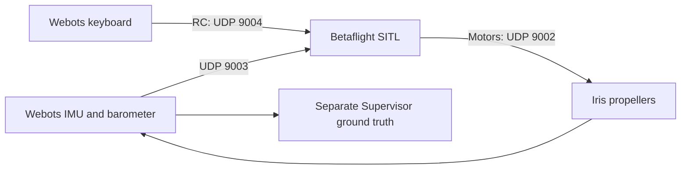

# Webots Betaflight simulation

Webots R2025a simulates the Iris quadcopter. Betaflight **2026.6.2** owns the
attitude/rate controller and mixer; the Webots controller supplies IMU and
barometer measurements, sends keyboard RC commands, and applies motor outputs.
The original telemetry-only mode remains available.

## Quick start

Run commands from the project root. For a new checkout, build and configure the
firmware once, then start automatic takeoff:

```bash
python3 tools/sitl.py build
python3 tools/sitl.py provision
python3 tools/takeoff.py
```

If the binary and EEPROM already exist, run only `python3 tools/takeoff.py`.
The drone arms automatically, climbs to 3 metres, and waits while holding
position. Click the Webots 3D viewport to send commands:

| Key | Automatic flight command |
| --- | --- |
| Right / Left | Move the east position target forward / backward |
| Up / Down | Move the north position target forward / backward |
| W / S | Raise / lower the altitude target |
| A / D | Change yaw |
| Space | Abort and disarm immediately; this stops motors, rather than landing |
| R | Retry takeoff after disarming and returning to the ground |

Release movement keys to hold the new target. Press Ctrl+C in the launch terminal
to close both Webots and SITL. If a port is occupied, close the previous simulation
or stop its launch task before retrying. Manual RC flight uses
`python3 tools/sitl.py launch`; its keyboard controls are listed below.



## Build and launch

Requirements: Webots on `PATH`, Python 3, Git, Make, a native C compiler, and the
existing Webots MCP installation at `/home/user/mcps/webotMCP`.

```bash
python3 tools/sitl.py build
python3 tools/sitl.py provision
python3 tools/sitl.py launch
```

| Location | Purpose |
| --- | --- |
| `bin/betaflight_SITL.elf` | Installed executable used by all launch/provision commands |
| `.sitl/betaflight-source/` | Pinned firmware checkout and build artifacts |
| `.sitl/runtime/eeprom.bin` | Persistent project-owned configuration |
| `.sitl/runtime/provision.log` | Configuration import output |

The builder pins release `2026.6.2` at
`e0b7bb01b17b21351057e9ead2d1ab39dd44fa16`, initializes its required submodules,
applies the local sensor and realtime-clock patches, and builds with
`-DSITL_EXTERNAL_BAROMETER -DSITL_WEBOTS_IMU_ONLY`. It installs the binary only
after a successful build. Generated binaries and runtime files are ignored by Git.

Provision **once** before first launch. Provisioning refuses to overwrite an
existing EEPROM; normal launches preserve it. To deliberately reset settings,
stop the simulation and move `.sitl/runtime/eeprom.bin` to a backup before
provisioning again. Inspect `provision.log` for configuration errors.

The combined launcher reports port conflicts and cleans up the child processes
it starts when either exits or the task is interrupted. It never stops another
simulation. Close an existing Webots world before launching another MCP world.
**After reloading/resetting the world, restart SITL too**: its receiver expects
simulation timestamps to advance.

In VS Code, use **Terminal → Run Task**:

- **Betaflight: Build SITL**
- **Betaflight: Provision new runtime**
- **Simulation: Launch Webots + Betaflight**
- **Simulation: Auto takeoff to 3 m**

For separate terminals, start **Betaflight: Run SITL**, then **Webots: Launch
SITL world**. **Webots: Launch drone world** runs telemetry only, with motors
stopped and no UDP bridge.

## Automatic takeoff and position hold

```bash
python3 tools/takeoff.py
```

This launches both processes, waits for firmware readiness with the arm switch
low, confirms arming through read-only MSP_STATUS, climbs to world altitude
**z=3 m**, and holds the takeoff XY position until keyboard commands arrive.
The Supervisor outer controller uses simulation position/velocity to generate
RC on **UDP 9004**. Betaflight receives only IMU/barometer sensor feedback.
MSP TCP 5761 is used for status only.

Click the Webots viewport after takeoff. Arrows move the east/north position
target at 0.5 m/s; W/S raise/lower the altitude target at 0.4 m/s; A/D change
yaw. Releasing a key holds the last target. Space immediately aborts and disarms;
R restarts the sequence only when the disarmed drone is back on the ground.
Feedback loss, firmware disarming, or tilt exceeding 45 degrees aborts without
automatic rearming. Ctrl+C stops both launched processes.

The controller assumes the pinned default Actual rates, 60-degree Angle limit,
linear throttle curve and 5.5% mixer idle. `webots.config` supplies conservative
Iris attitude gains. Existing installations must rebuild for the clock patch
and import the updated configuration while the simulation is stopped:

```bash
python3 tools/sitl.py build
cp -n .sitl/runtime/eeprom.bin .sitl/runtime/eeprom.before-auto-takeoff.bin
(cd .sitl/runtime && ../../bin/betaflight_SITL.elf --config ../../config/betaflight/webots.config > auto-config.log 2>&1)
```

This imports the listed settings into the existing EEPROM, without a reset.
Inspect `auto-config.log` for `###ERROR` before launch. This workspace already
has the updated binary and tuning; its original EEPROM is backed up at
`.sitl/runtime/eeprom.before-auto-takeoff.bin`.

## Keyboard RC

Click the Webots 3D viewport to give it keyboard focus. The drone starts disarmed.

| Key | Command |
| --- | --- |
| R | Request arm at zero throttle after two seconds of valid motor feedback and firmware readiness |
| Space | Immediately disarm, reset throttle, and stop motors locally |
| W / S | Increase / decrease retained throttle by 0.01 per RC update |
| Left / Right | Roll stick −0.2 / +0.2 |
| Up / Down | Pitch stick +0.2 / −0.2 |
| A / D | Yaw stick −0.2 / +0.2 |

Roll, pitch, and yaw return to neutral when released. Throttle stays at its last
value. The arm request is not confirmation that firmware armed: firmware still
checks calibration and its own arming conditions. Angle mode is always selected.
The configuration uses AETR, AUX1 arm, AUX2 Angle mode, and DROP failsafe.
`NOT_DISARMED` can appear while already armed. `ARM_SWITCH` means the arm switch
must return low after another arming condition or receiver loss. The bridge
checks actual firmware arm status and sends low throttle until arming succeeds.

The bridge runs only when `WEBOTS_BETAFLIGHT_SITL=1`. Ports are fixed on loopback:

| Direction | Port | Wire layout |
| --- | --- | --- |
| Sensor feedback → SITL | UDP 9003 | `<18d`, 144 bytes, every 2 ms simulation step |
| RC → SITL | UDP 9004 | `<d16H`, 40 bytes, 50 Hz wall-clock heartbeat |
| Status → bridge | TCP 5761 | Read-only MSP_STATUS at approximately 10 Hz |
| Motors → Webots | UDP 9002 | `<4f`, 16 bytes, normalized QUADX outputs |

The feedback packet includes time, gyro `(x,-y,-z)`, negated accelerometer values,
a reserved identity quaternion, six zero position/velocity values, and pressure
in Pa. The strict build estimates attitude from IMU, disables synthetic MAG/GPS,
and reads transmitted pressure directly. No ground-truth position or attitude
enters its estimator. GPS remains compiled as an unused feature, disabled in
configuration; no virtual GPS updates occur.
The strict build uses a monotonic realtime clock: individual UDP packet arrival
intervals cannot accelerate firmware receiver/failsafe timers. Run Webots in
realtime mode.

QUADX slots rear-right/front-right/rear-left/front-left map to
`m4_motor/m1_motor/m2_motor/m3_motor`. Motor commands are positive normalized
output × 100 rad/s through a 50 ms motor response; existing motor multipliers set rotation direction. Webots
propellers turn angular velocity into quadratic thrust and reaction torque.
Mass, inertia, and propeller constants remain unchanged.

Motor packets must contain four finite values in `[0,1]`. Malformed packets do
not refresh the watchdog. Reception drains at most 64 datagrams per physics step.
After 250 ms without a valid motor packet, using wall-clock time, motors stop and
the arm request is cleared. Recovery needs a fresh R press after the two-second
connection interval. Space and controller shutdown also stop motors locally.
The RC heartbeat sends disarmed channels if control updates are stale for 250 ms.
MSP status older than 500 ms also prevents applying motor commands.

## MCP inspection and telemetry

The shared Codex Webots MCP runs
`/home/user/mcps/webotMCP/venv/bin/python /home/user/mcps/webotMCP/server/main.py`.
It requires `mcp[cli]>=1.16.0,<2`. The launch tasks set
`WEBOTS_EXTRA_PROJECT_PATH=/home/user/mcps/webotMCP` to reuse the bridge controller.
The MCP bridge uses TCP ports 10022 and 10023, separately from SITL.

Use `get_simulation_state`, `get_scene_tree`, or `get_viewport_screenshot`. Read
the approximately 10 Hz drone telemetry with `execute_supervisor_code`:

```python
import json
result = json.loads(supervisor.getFromDef('DRONE').getField('customData').getSFString())
```

| Field | Meaning |
| --- | --- |
| `time_s` | Simulation seconds |
| `imu.acceleration_body_m_s2` | Body specific force, m/s²; stationary level readings are approximately `(0,0,9.81)` |
| `imu.angular_velocity_body_rad_s` | Body angular velocity, rad/s |
| `barometer.pressure_pa` | Standard-atmosphere pressure; 101325 Pa at world z=0 |
| `ground_truth.position_enu_m` | Simulation position in metres: east/north/up |
| `ground_truth.orientation_body_to_enu` | Row-major 3×3 body-to-world rotation matrix |
| `sitl.enabled`, `sitl.connected` | Bridge enabled and motor feedback fresh |
| `sitl.motor_age_s` | Last valid motor packet's wall-clock age, or null before reception |
| `sitl.arm_requested`, `sitl.rc_channels_us` | Local arm request and sixteen RC channels |
| `sitl.armed`, `sitl.arming_disable_flags` | Confirmed firmware arm state and disable bitmask; null flags when status is stale |
| `sitl.auto_phase`, `sitl.auto_fault` | Automatic flight phase and latched abort reason |
| `sitl.position_target_enu_m` | Automatic position target, or null in manual mode |
| `sitl.motor_outputs` | Fresh normalized outputs in QUADX order; zero when stale |
| `sitl.motor_names`, `sitl.applied_motor_commands_rad_s` | Device mapping and commanded speeds in matching QUADX order |

Pressure is computed from Supervisor altitude with no bias/noise, using the
standard atmosphere below 11 km. The only physical sensor devices are the
accelerometer and gyro. Simulation ground truth feeds the outer position
controller separately from sensor feedback.

## Checks and limits

```bash
python3 -m unittest discover -s tests -v
python3 controllers/drone_telemetry/drone_telemetry.py --self-test
```

The tests cover packet layout, sensor signs, motor mapping, malformed/stale
packets, arming/rearming, stick release, throttle bounds, port conflicts, and
EEPROM preservation. Firmware compilation enforces the IMU estimator rather
than direct attitude; its startup banner identifies the strict sensor build.
Live Webots/SITL checks verified takeoff and hold at approximately 3.01 m,
recovery from a 0.3/0.2 m/s horizontal and 0.1 rad/s yaw disturbance, keyboard
setpoint movement and release hold, and Space disarming with zero applied motors.

MSP command input remains a later milestone. Strict IMU sensing provides no
absolute yaw reference. This is a simulation controller with bounded keyboard
setpoints, not an aircraft flight tune. Changing rates, mixer idle, mass or
propeller constants requires retesting the outer controller.

## Provenance

`protos/Iris.proto` and its meshes come from ArduPilot commit
`940234e0e9b1a04060c773e090a1c5bfe0ff8d8f`, under
`libraries/SITL/examples/Webots_Python/protos`. The local PROTO removes GPS and
InertialUnit and uses the R2025a file format. Its original empirical physics are
preserved and are not a calibration for a particular aircraft.

The protocol and barometer patch were adapted from
`/home/user/learnning/drone_physics_and_simulation/examples/08-betaflight-sitl/bridge`
and that repository's `tools/`. GPLv3 is included in `LICENSE`.

## Git initialization

To put a fresh project copy under Git and create its first commit:

```bash
git init
git add .
git commit -m "project init"
```

This workspace already has a Git repository, so subsequent updates need only
`git add .` and `git commit -m "your message"`. The `.gitignore` excludes generated
binaries, firmware downloads, EEPROM settings and Python cache files.
