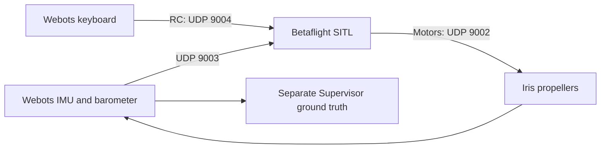

# Webots Betaflight simulation

Webots R2025a simulates the Iris quadcopter. Betaflight **2026.6.2** owns the
attitude/rate controller and mixer; the Webots controller supplies IMU and
barometer measurements, sends keyboard RC commands, and applies motor outputs.
The original telemetry-only mode remains available.



## Build and launch

Requirements: Webots on `PATH`, Python 3, Git, Make, a native C compiler, and the
existing Webots MCP installation at `/home/user/mcps/webotMCP`.

```bash
python3 tools/sitl.py build
python3 tools/sitl.py provision
python3 tools/sitl.py launch
```

| Location | Purpose |
| --- | --- |
| `bin/betaflight_SITL.elf` | Installed executable used by all launch/provision commands |
| `.sitl/betaflight-source/` | Pinned firmware checkout and build artifacts |
| `.sitl/runtime/eeprom.bin` | Persistent project-owned configuration |
| `.sitl/runtime/provision.log` | Configuration import output |

The builder pins release `2026.6.2` at
`e0b7bb01b17b21351057e9ead2d1ab39dd44fa16`, initializes its required submodules,
applies the two local patches, and builds with
`-DSITL_EXTERNAL_BAROMETER -DSITL_WEBOTS_IMU_ONLY`. It installs the binary only
after a successful build. Generated binaries and runtime files are ignored by Git.

Provision **once** before first launch. Provisioning refuses to overwrite an
existing EEPROM; normal launches preserve it. To deliberately reset settings,
stop the simulation and move `.sitl/runtime/eeprom.bin` to a backup before
provisioning again. Inspect `provision.log` for configuration errors.

The combined launcher reports port conflicts and cleans up the child processes
it starts when either exits or the task is interrupted. It never stops another
simulation. Close an existing Webots world before launching another MCP world.
**After reloading/resetting the world, restart SITL too**: its receiver expects
simulation timestamps to advance.

In VS Code, use **Terminal → Run Task**:

- **Betaflight: Build SITL**
- **Betaflight: Provision new runtime**
- **Simulation: Launch Webots + Betaflight**

For separate terminals, start **Betaflight: Run SITL**, then **Webots: Launch
SITL world**. **Webots: Launch drone world** runs telemetry only, with motors
stopped and no UDP bridge.

## Keyboard RC

Click the Webots 3D viewport to give it keyboard focus. The drone starts disarmed.

| Key | Command |
| --- | --- |
| R | Request arm at zero throttle after two seconds of continuous valid motor feedback |
| Space | Immediately disarm, reset throttle, and stop motors locally |
| W / S | Increase / decrease retained throttle by 0.01 per RC update |
| Left / Right | Roll stick −0.2 / +0.2 |
| Up / Down | Pitch stick +0.2 / −0.2 |
| A / D | Yaw stick −0.2 / +0.2 |

Roll, pitch, and yaw return to neutral when released. Throttle stays at its last
value. The arm request is not confirmation that firmware armed: firmware still
checks calibration and its own arming conditions. Angle mode is always selected.
The configuration uses AETR, AUX1 arm, AUX2 Angle mode, and DROP failsafe.

The bridge runs only when `WEBOTS_BETAFLIGHT_SITL=1`. Ports are fixed on loopback:

| Direction | Port | Wire layout |
| --- | --- | --- |
| Sensor feedback → SITL | UDP 9003 | `<18d`, 144 bytes, every 2 ms simulation step |
| RC → SITL | UDP 9004 | `<d16H`, 40 bytes, at 50 Hz simulation time |
| Motors → Webots | UDP 9002 | `<4f`, 16 bytes, normalized QUADX outputs |

The feedback packet includes time, gyro `(x,-y,-z)`, negated accelerometer values,
a reserved identity quaternion, six zero position/velocity values, and pressure
in Pa. The strict build estimates attitude from IMU, disables synthetic MAG/GPS,
and reads transmitted pressure directly. No ground-truth position or attitude
enters its estimator. GPS remains compiled as an unused feature, disabled in
configuration; no virtual GPS updates occur.

QUADX slots rear-right/front-right/rear-left/front-left map to
`m4_motor/m1_motor/m2_motor/m3_motor`. Motor commands are positive normalized
output × 100 rad/s; existing motor multipliers set rotation direction. Webots
propellers turn angular velocity into quadratic thrust and reaction torque.
Mass, inertia, and propeller constants remain unchanged.

Motor packets must contain four finite values in `[0,1]`. Malformed packets do
not refresh the watchdog. Reception drains at most 64 datagrams per physics step.
After 250 ms without a valid motor packet, using wall-clock time, motors stop and
the arm request is cleared. Recovery needs a fresh R press after the two-second
connection interval. Space and controller shutdown also stop motors locally.

## MCP inspection and telemetry

The shared Codex Webots MCP runs
`/home/user/mcps/webotMCP/venv/bin/python /home/user/mcps/webotMCP/server/main.py`.
It requires `mcp[cli]>=1.16.0,<2`. The launch tasks set
`WEBOTS_EXTRA_PROJECT_PATH=/home/user/mcps/webotMCP` to reuse the bridge controller.
The MCP bridge uses TCP ports 10022 and 10023, separately from SITL.

Use `get_simulation_state`, `get_scene_tree`, or `get_viewport_screenshot`. Read
the approximately 10 Hz drone telemetry with `execute_supervisor_code`:

```python
import json
result = json.loads(supervisor.getFromDef('DRONE').getField('customData').getSFString())
```

| Field | Meaning |
| --- | --- |
| `time_s` | Simulation seconds |
| `imu.acceleration_body_m_s2` | Body specific force, m/s²; stationary level readings are approximately `(0,0,9.81)` |
| `imu.angular_velocity_body_rad_s` | Body angular velocity, rad/s |
| `barometer.pressure_pa` | Standard-atmosphere pressure; 101325 Pa at world z=0 |
| `ground_truth.position_enu_m` | Simulation position in metres: east/north/up |
| `ground_truth.orientation_body_to_enu` | Row-major 3×3 body-to-world rotation matrix |
| `sitl.enabled`, `sitl.connected` | Bridge enabled and motor feedback fresh |
| `sitl.motor_age_s` | Last valid motor packet's wall-clock age, or null before reception |
| `sitl.arm_requested`, `sitl.rc_channels_us` | Local arm request and sixteen RC channels |
| `sitl.motor_outputs` | Fresh normalized outputs in QUADX order; zero when stale |
| `sitl.motor_names`, `sitl.applied_motor_commands_rad_s` | Device mapping and commanded speeds in matching QUADX order |

Pressure is computed from Supervisor altitude with no bias/noise, using the
standard atmosphere below 11 km. The only physical sensor devices are the
accelerometer and gyro. Simulation ground truth remains available for the later
outer position controller, separately from sensor feedback.

## Checks and limits

```bash
python3 -m unittest discover -s tests -v
python3 controllers/drone_telemetry/drone_telemetry.py --self-test
```

The tests cover packet layout, sensor signs, motor mapping, malformed/stale
packets, arming/rearming, stick release, throttle bounds, port conflicts, and
EEPROM preservation. Firmware compilation enforces the IMU estimator rather
than direct attitude; its startup banner identifies the strict sensor build.

MSP command input, position setpoints, and autonomous hover are later milestones.
Strict IMU sensing provides no absolute yaw reference. Iris flight behavior must
be verified with live axis/disturbance checks; the PyBullet reference's gains and
hover results are not evidence for this model.

## Provenance

`protos/Iris.proto` and its meshes come from ArduPilot commit
`940234e0e9b1a04060c773e090a1c5bfe0ff8d8f`, under
`libraries/SITL/examples/Webots_Python/protos`. The local PROTO removes GPS and
InertialUnit and uses the R2025a file format. Its original empirical physics are
preserved and are not a calibration for a particular aircraft.

The protocol and barometer patch were adapted from
`/home/user/learnning/drone_physics_and_simulation/examples/08-betaflight-sitl/bridge`
and that repository's `tools/`. GPLv3 is included in `LICENSE`.
